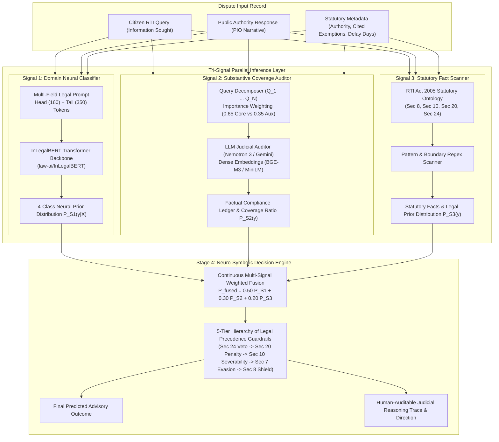

# An Explainable Neuro-Symbolic AI Advisory System for RTI Decision Outcome Prediction

[](https://github.com/Ajai-R/Neuro-Symbolic-Ai-Judge/actions/workflows/ci.yml)
[](https://www.python.org/)
[](https://react.dev/)
[](https://vitejs.dev/)
[](LICENSE)

**Academic Project | Department of Computer Science & Engineering**  
**Amrita School of Computing, Amrita Vishwa Vidyapeetham, Chennai Campus**  
* **Batch ID**: BATCH ID-30  
* **Student Members**: Ajai R, Gowtham Hari S  
* **Faculty Guide**: Mrs. Nivethitha V (Assistant Professor - CSE)

---

## 1. Project Motivation & Problem Statement

### The Administrative Backlog Crisis
Under the **Right to Information (RTI) Act, 2005**, Indian citizens possess a constitutional entitlement under Article 19(1)(a) to audit administrative conduct and request public records. However, the quasi-judicial appellate mechanism faces severe systemic delays:
* **Over 4,05,500 second appeals and complaints** remain pending across India's 29 Central and State Information Commissions.
* The **Central Information Commission (CIC)** carries a persistent backlog exceeding 22,500 disputes.
* In multiple State Information Commissions, disposal waiting times range between **4 to 5 years**, functionally eroding the constitutional mandate of time-bound transparency.

### The Problem of "Strategic Bureaucratic Ambiguity"
Public Information Officers (PIOs) frequently counter citizen requests using evasive administrative tactics:
1. **Voluminous Partial Disclosure**: Furnishing hundreds of pages of procedural correspondence while silently withholding the core operative file, sanction order, or audit ledger.
2. **Blanket Statutory Exemption Claims**: Invoking Section 8(1)(j) (personal privacy) or Section 8(1)(d) (commercial confidence) without satisfying the statutory balancing test.
3. **Jurisdictional Deflection**: Citing Section 24 (Second Schedule intelligence exemptions) even when allegations of corruption or human rights violations are explicitly raised.

### Why Pure Generative LLMs Fail in Judicial Triage
Standard Large Language Models (LLMs) operate probabilistically:
* **Generative Hallucinations**: Standard LLMs invent non-existent statutory sections, cite inapplicable precedents, and produce ungrounded outcome predictions. In administrative law and judicial adjudication, probabilistic uncertainty is legally inadmissible.
* **Lack of Verifiable Audit Trails**: Pure deep neural networks operate as black boxes, incapable of providing deterministic guarantees that statutory boundaries were respected.
* **The Neuro-Symbolic Imperative**: This system combines **Neural Perception** (transformer sequence classification and LLM semantic auditing) with a **Deterministic Statutory Logic Matrix** grounded in the RTI Act, 2005. It functions as an **Explainable First-Pass Advisory Filter** for First Appellate Authorities (FAAs) and Information Commissioners, preserving human judicial discretion while automating triage.

---

## 2. Complete System Architecture

The pipeline processes unseen RTI disputes through a **4-stage tri-signal neuro-symbolic framework**:



---

## 3. Deep Dive into the Tri-Signal Architecture

### Signal 1: Neural Outcome Classifier (`signal_1_inlegalbert/`)
* **Transformer Backbone**: `law-ai/InLegalBERT`, pre-trained on Indian Supreme Court and High Court judgments.
* **Input Tokenization**: Head (160) + Tail (350) structured window across 512 maximum tokens:
  ```
  [CITIZEN QUERY]: <information_sought>
  [EXEMPTIONS CITED]: <exemptions_cited>
  [PUBLIC AUTHORITY]: <public_authority>
  [CASE NARRATIVE & PROCEEDINGS]: <case_narrative>
  ```
* **Two-Stage Fine-Tuning**:
  - **Stage 1 (Warmup)**: InLegalBERT backbone frozen; classification head and pooler trained ($lr = 1\times 10^{-3}$, 2 epochs).
  - **Stage 2 (Joint Adaptation)**: Top-4 transformer layers fine-tuned ($lr = 2\times 10^{-5}$) with classification head ($lr = 1\times 10^{-4}$, 6 epochs) using balanced inverse-frequency cross-entropy loss.
* **Signal 1 Performance on Blind Unseen Test Set ($N=424$)**:
  - **Test Accuracy**: **`73.11%`**
  - **Macro F1-Score**: **`73.35%`**
  - **Weighted F1-Score**: **`73.35%`**

---

### Signal 2: Substantive Coverage Verification (`signal_2_coverage/`)
* **Objective**: Defeat administrative evasion by evaluating whether the public authority furnished the substantive records demanded.
* **Discrete Query Decomposition**:
  - Extracts each operative query item $Q_1, Q_2, \dots, Q_N$.
  - Assigns dynamic legal importance:
    - `CORE_OPERATIVE_DEMAND` ($\text{weight} \approx 0.65$): Substantive records, tenders, sanction orders, file notings.
    - `AUXILIARY_INQUIRY` ($\text{weight} \approx 0.35$): Procedural inward numbers, dates, designations.
* **Substantive Disclosure Assessment**:
  - Evaluates whether information was:
    - $\mathbf{FURNISHED}$ ($1.0$): Certified records supplied.
    - $\mathbf{PARTIALLY\_FURNISHED}$ ($0.5$): Incomplete reply or summary without primary records.
    - $\mathbf{WITHHELD\_WITH\_STATUTORY\_CLAIM}$ ($0.0$): Denied citing valid statutory exemptions.
    - $\mathbf{NOT\_PROVIDED\_EVADED}$ ($0.0$): Administrative silence, deflection, or omission.
* **Dual Execution Engine**: Powered by OpenRouter (`nvidia/nemotron-3-ultra-550b-a55b:free` with Gemini failover) and dense vector semantic similarity (`BAAI/bge-m3` and `sentence-transformers/all-MiniLM-L6-v2`) with zero-downtime heuristic fallback.

---

### Signal 3: Statutory Fact & Boundary Scanner (`signal_3/`)
* **Objective**: Extract hard statutory boundary conditions under the RTI Act, 2005.
* **Formal Legal Ontology (`signal_3/ontology.py`)**:
  - **Section 8(1)(a) to 8(1)(j)**: Exemptions covering national sovereignty, contempt of court, parliamentary privilege, commercial confidence (`8(1)(d)`), fiduciary trust (`8(1)(e)`), pending prosecution (`8(1)(h)`), and personal privacy (`8(1)(j)`).
  - **Section 24 (Second Schedule)**: Complete jurisdictional bar for intelligence and security organizations (e.g., Intelligence Bureau, RAW, CBI, BSF, CRPF) with proviso detection for corruption or human rights violations.
  - **Section 20(1) & 20(2)**: Statutory penal sanction indicators (unreasonable delay $> 30$ days, malafide obstruction, destroyed records, show-cause notices).
  - **Section 10(1)**: Doctrine of Severability indicators where non-exempt portions can be severed.

---

### Stage 4: Neuro-Symbolic Decision Engine (`decision_engine/`)

The master synthesis engine operates in two sequential stages:

#### Step 1: Continuous Multi-Signal Weighted Probabilistic Fusion
Computes the convex combination of normalized class probability vectors across all three signals:
$$P_{\text{fused}}(y) = w_1 \cdot P_{S1}(y) + w_2 \cdot P_{S2}(y) + w_3 \cdot P_{S3}(y)$$
* $w_1 = 0.50$ (Neural Prior — InLegalBERT)
* $w_2 = 0.30$ (Factual Coverage — Signal 2)
* $w_3 = 0.20$ (Statutory Rules — Signal 3)
* $\sum_{i=1}^3 w_i = 1.0$

#### Step 2: 5-Tier Hierarchy of Legal Precedence Guardrails
Enforces non-negotiable legal rules that override pure probabilistic consensus when statutory boundaries are violated:

| Precedence Tier | Guardrail Rule | Legal Basis | Trigger Condition | Mandatory Outcome |
| :---: | :--- | :--- | :--- | :--- |
| **Tier 1** | `SEC24_JURISDICTIONAL_IMMUNITY_VETO` | Section 24(1) | Public Authority is an exempt Second Schedule security agency without corruption proviso. | **`APPEAL_DISMISSED`** ($99\%$) |
| **Tier 2** | `SEC20_STATUTORY_PENAL_SANCTION` | Section 20(1)/(2) | Unjustified delay $> 30$ days, malafide denial, or explicit show-cause notice issued. | **`PENALTY_IMPOSED`** ($95\%$) |
| **Tier 3** | `SEC10_SEVERABILITY_MANDATE` | Section 10(1) | Mixed compliance (items furnished while others omitted) with valid partial exemptions. | **`PARTIAL_RELIEF`** ($92\%$) |
| **Tier 4** | `UNJUSTIFIED_EVASION_OVERRULE` | Section 7(1) | Records missing/evaded while citing **zero statutory exemptions** under Section 8(1). | **`INFORMATION_DIRECTED`** ($89\%$) |
| **Tier 5** | `SEC8_EXEMPTION_SUSTAINED` | Section 8(1) | Valid statutory exemption (e.g. 8(1)(j), 8(1)(d)) legitimately invoked over third-party records. | **`APPEAL_DISMISSED`** ($88\%$) |
| **Level 6** | `WEIGHTED_PROBABILISTIC_CONSENSUS` | Multi-Signal | No statutory boundary violated; dispute falls within standard judicial discretion. | **Accept Weighted Top Class** |

---

## 4. Benchmark Evaluation & Results

The complete Neuro-Symbolic Decision Engine was benchmarked on the **strictly unseen, blind test set ($N=424$)**:

### Comprehensive Test Benchmark Performance ($N=424$)

| Outcome Class | Precision | Recall | F1-Score | Test Support |
| :--- | :---: | :---: | :---: | :---: |
| **`INFORMATION_DIRECTED`** | **0.78** | **0.85** | **0.81** | 106 |
| **`APPEAL_DISMISSED`** | **0.78** | **0.87** | **0.82** | 106 |
| **`PENALTY_IMPOSED`** | **0.91** | **0.89** | **0.90** | 106 |
| **`PARTIAL_RELIEF`** | **0.97** | **0.80** | **0.88** | 106 |
| **Overall Accuracy** | — | — | **`85.14%`** | 424 |
| **Macro Average** | **0.86** | **0.85** | **`85.29%`** | 424 |
| **Weighted Average** | **0.86** | **0.85** | **`85.29%`** | 424 |

* **Total Benchmark Inference Time**: 148.7 seconds (Average **`0.351 seconds/case`**).
* **Statutory Guardrail Override Rate**: **`5.66%`** (24 out of 424 unseen disputes were actively rescued from erroneous neural consensus by symbolic guardrails).

### Master Confusion Matrix ($N=424$)

| Actual \ Predicted | `INFORMATION_DIRECTED` | `APPEAL_DISMISSED` | `PENALTY_IMPOSED` | `PARTIAL_RELIEF` | Total |
| :--- | :---: | :---: | :---: | :---: | :---: |
| **`INFORMATION_DIRECTED`** | **90** | 13 | 3 | 0 | 106 |
| **`APPEAL_DISMISSED`** | 10 | **92** | 3 | 1 | 106 |
| **`PENALTY_IMPOSED`** | 5 | 5 | **94** | 2 | 106 |
| **`PARTIAL_RELIEF`** | 10 | 8 | 3 | **85** | 106 |

### Comparative Ablation Analysis

| System / Model Configuration | Accuracy | Macro F1 | Hallucination-Free | Statutory Grounding |
| :--- | :---: | :---: | :---: | :---: |
| Majority Class Baseline | 25.00% | 10.00% | N/A | None |
| Zero-Shot Mistral-7B Baseline | 57.30% | 37.00% | No (Hallucinates) | None |
| Signal 1 Alone (InLegalBERT) | 73.11% | 73.35% | No (Black-Box) | Implicit |
| Weighted Consensus (No Guardrails) | 81.60% | 81.72% | Partial | Weak |
| **Full Neuro-Symbolic Advisory System** | **`85.14%`** | **`85.29%`** | **Yes (100% Deterministic)** | **Strict RTI Act 2005** |

---

## 5. Dataset Architecture & Specification

> **Note on Data Availability**: Raw dataset files and CSV tables are excluded from this git repository to prevent accidental licensing/privacy leakage. Complete data pipeline scripts to ingest, denoise, harmonize, and split the benchmark are provided in [`src/data_preprocessing.py`](src/data_preprocessing.py) and [`src/combine_datasets.py`](src/combine_datasets.py).

### Dual-Source Origin
1. **Source A (HuggingFace Benchmark)**: 1,218 historic instruction-response disputes annotated from Central Information Commission archives.
2. **Source B (Quasi-Judicial Decisions 2023–2026)**: 298 structured decision records parsed from official CIC decision PDFs across 5 Central Information Commissioners.
3. **Augmented Balanced Benchmark**: Expanded to exactly **2,120 unique, leak-free cases** balanced across the 4 core adjudication classes (530 cases per class).

### Stratified 80/20 Leak-Free Partitioning

| Outcome Class | Clean Total ($N=2,120$) | Train Count ($N=1,696$) | Train % | Test Count ($N=424$) | Test % |
| :--- | :---: | :---: | :---: | :---: | :---: |
| **`INFORMATION_DIRECTED`** | 530 | 424 | 25.00% | 106 | 25.00% |
| **`APPEAL_DISMISSED`** | 530 | 424 | 25.00% | 106 | 25.00% |
| **`PENALTY_IMPOSED`** | 530 | 424 | 25.00% | 106 | 25.00% |
| **`PARTIAL_RELIEF`** | 530 | 424 | 25.00% | 106 | 25.00% |
| **Total** | **2,120** | **1,696** | **100.00%** | **424** | **100.00%** |

* **Zero Leakage Guarantee**: 0% overlap in `case_id` and 0% overlap in `case_narrative` between training and testing sets.
* **Strict Evaluation Isolation**: The `ruling_text` column contains the Commission's historical order, reserved strictly for post-hoc validation; it is never exposed to models during training or inference.

### Unified 8-Column Schema
All cases conform to the following schema:
1. `case_id`: Unique identifier (e.g. `HF_0142` or `CIC/DOURD/A/2023/110294`).
2. `source`: Provenance tag (`source_a_hf` vs `source_b_cic_pdf`).
3. `case_narrative`: Pre-adjudication factual dispute text (citizen request, PIO response, first appeal grounds).
4. `information_sought`: Itemized statement of what records the citizen demanded.
5. `exemptions_cited`: Validated JSON list of statutory clauses cited (e.g. `["8(1)(j)", "8(1)(e)"]`).
6. `outcome`: Ground-truth adjudication class (`INFORMATION_DIRECTED`, `APPEAL_DISMISSED`, `PENALTY_IMPOSED`, `PARTIAL_RELIEF`).
7. `ruling_text`: Commission's official judgment text (for audit evaluation only).
8. `public_authority`: Respondent ministry or public authority.

### Automated Text Preprocessing Pipeline (`src/data_preprocessing.py`)
- **Unicode NFKC Normalization**: Strips soft hyphens (`\xad`), non-breaking spaces (`\xa0`), and resolves mojibake replacement characters (`\ufffd`).
- **Typographic Dash & Smart Quote Normalization**: Maps curly quotes (`’`, `”`) and typographic dashes to standard ASCII.
- **Abbreviation-Dot Query Recovery**: Reconstructs truncated queries cut off at abbreviations (e.g., `"form no."`, `"sec."`).
- **Paragraph Number Inline Formatting**: Unifies broken numbered paragraphs (e.g., `'4. \nThe Commission...'` $\rightarrow$ `'4. The Commission...'`).

---

## 6. Repository Structure

```
Neuro-Symbolic-Ai-Judge/
├── .github/
│   └── workflows/
│       └── ci.yml                     # Continuous Integration workflow (Python + Node.js)
├── .env.example                       # Environment variables configuration template
├── .gitignore                         # Ignore rules for datasets, binary weights, caches
├── README.md                          # Comprehensive system architecture & benchmark guide
├── requirements.txt                   # Production Python dependencies
├── backend_server.py                  # Live API Server (Threading HTTP on port 8000)
├── decision_engine/                   # Stage 4: Master Neuro-Symbolic Synthesis Engine
│   ├── __init__.py
│   ├── master_engine.py               # Tri-signal orchestrator & decision synthesis
│   ├── symbolic_guardrails.py         # 5-tier statutory legal guardrails hierarchy
│   ├── weighted_fusion.py             # Multi-signal mathematical weighted consensus
│   ├── weights_config.py              # Calibrated weights (w1=0.50, w2=0.30, w3=0.20)
│   ├── signal_adapters.py             # Adapter layer standardizing raw signal outputs
│   ├── benchmark_test_set.py          # Benchmark evaluation script for test set
│   ├── test_engine.py                 # Engine unit tests & sanity runner
│   ├── test_evaluation_report.json    # Exact benchmark test report (85.14% Acc, 85.29% F1)
│   └── overall_test_evaluation_results.txt # Full benchmark execution log on 424 test cases
├── signal_1_inlegalbert/              # Signal 1: Domain Neural Classifier
│   ├── __init__.py
│   ├── dataset.py                     # Head (160) + Tail (350) legal tokenizer
│   ├── model.py                       # InLegalBERT 4-class classification head & freezing
│   ├── train.py                       # Two-stage GPU fine-tuning pipeline
│   ├── evaluate.py                    # Evaluation metrics & confusion matrix generator
│   ├── predict.py                     # Standalone inference & class probability predictor
│   └── checkpoints/
│       ├── test_evaluation_report.json # Signal 1 test metrics (73.11% Acc, 73.35% F1)
│       ├── training_history.json      # Loss and validation curves across epochs
│       └── best_model/                # Model configuration & tokenizer assets
│           ├── config.json
│           ├── label_mapping.json
│           ├── tokenizer.json
│           └── tokenizer_config.json
├── signal_2_coverage/                 # Signal 2: Substantive Coverage Verification
│   ├── __init__.py
│   ├── config.py                      # Calibrated coverage & similarity thresholds
│   ├── extractor.py                   # Legal sentence splitter & query itemizer
│   ├── matcher.py                     # BGE-M3 / MiniLM dense semantic alignment matcher
│   ├── llm_judge.py                   # LLM Judicial Auditor (Nemotron/Gemini + fallback)
│   ├── explainability.py              # Visual coverage ledger & markdown matrix generator
│   ├── pipeline.py                    # Complete Signal 2 compliance audit pipeline
│   └── test_sample.py                 # Signal 2 test script
├── signal_3/                          # Signal 3: Statutory Fact & Boundary Scanner
│   ├── __init__.py
│   ├── ontology.py                    # RTI Act, 2005 Formal Statutory Ontology
│   ├── scanner.py                     # Pattern & regex scanner extracting statutory facts
│   ├── engine.py                      # Symbolic legal synthesis rules
│   ├── pipeline.py                    # End-to-end Signal 3 pipeline
│   └── test_signal3.py                # Statutory boundary verification tests
├── src/                               # Data engineering & preprocessing pipeline
│   ├── __init__.py
│   ├── data_preprocessing.py          # Denoising, text normalization, and leak-free splitting
│   └── combine_datasets.py            # Dual-source harmonization and balanced 80/20 partitioning
├── tests/                             # Automated test suite for CI
│   ├── __init__.py
│   ├── test_weighted_fusion.py        # Validates multi-signal mathematical consensus
│   └── test_statutory_guardrails.py   # Validates all 5 statutory precedence guardrails
├── frontend/                          # Explainable Advisory Dashboard (React 19 + Vite)
│   ├── index.html
│   ├── package.json
│   ├── vite.config.js
│   ├── .gitignore
│   ├── public/
│   └── src/
│       ├── main.jsx
│       ├── App.jsx
│       ├── App.css
│       ├── index.css                  # Dark-mode glassmorphic design system
│       ├── components/                # Glassmorphic UI cards & visualizers
│       ├── data/                      # Preset benchmark demonstration cases
│       └── services/                  # Live API service & offline pipeline engine
├── figures/                           # Visual architecture & evaluation diagrams
│   ├── fig31_pipeline_overview.png
│   ├── fig32_signal1_architecture.png
│   ├── fig33_signal1_learning_curve.png
│   ├── fig34_signal1_confusion_matrix.png
│   ├── fig35_signal2_architecture.png
│   ├── fig36_signal3_architecture.png
│   ├── fig37_decision_engine_guardrails.png
│   ├── fig38_ablation_comparison.png
│   └── fig39_master_confusion_matrix.png
└── research_paper/                    # Academic publication & LaTeX source
    ├── IEEE_Research_Paper_RTI_NeuroSymbolic.tex
    ├── IEEE_Research_Paper_RTI_NeuroSymbolic.pdf
    └── generate_paper_figures.py
```

---

## 7. Installation & Quickstart Guide

### Prerequisites
* **Python**: 3.10, 3.11, or 3.12 (CUDA 11.8 / 12.1 recommended for GPU fine-tuning)
* **Node.js**: v18+ or v20+ with `npm`

### Step 1: Clone the Repository
```bash
git clone https://github.com/Ajai-R/Neuro-Symbolic-Ai-Judge.git
cd Neuro-Symbolic-Ai-Judge
```

### Step 2: Set Up Python Backend Environment
```bash
# Create and activate virtual environment
python -m venv venv
# On Windows:
.\venv\Scripts\activate
# On Linux/macOS:
source venv/bin/activate

# Install dependencies
pip install -r requirements.txt
```

### Step 3: Configure Environment Variables
Copy `.env.example` to `.env`:
```bash
cp .env.example .env
```
Open `.env` and set your OpenRouter API key (or Google Gemini API key):
```ini
OPENROUTER_API_KEY=your_openrouter_api_key_here
OPENROUTER_MODEL=nvidia/nemotron-3-ultra-550b-a55b:free
GEMINI_API_KEY=your_gemini_api_key_here
```
*(Note: If no API key is set, Signal 2 automatically operates using its built-in rule-based heuristic fallback engine with zero downtime.)*

### Step 4: Run the Automated Unit Tests
```bash
python -m unittest discover tests -v
```
All tests for mathematical weighted fusion and the 5-tier statutory guardrails hierarchy should pass with `OK`.

### Step 5: Start the Backend API Server
```bash
python backend_server.py 8000
```
The server will initialize and listen on `http://127.0.0.1:8000/`.
* Health check: `GET http://127.0.0.1:8000/`
* Tri-signal inference endpoint: `POST http://127.0.0.1:8000/api/decision_engine`

### Step 6: Start the Frontend Dashboard
In a separate terminal:
```bash
cd frontend
npm install
npm run dev
```
Open your browser at `http://localhost:5173/` to interact with the Explainable Advisory Dashboard.

---

## 8. API Specification

### Endpoint: `POST /api/decision_engine`

#### Request Payload
```json
{
  "citizen_query": "Provide certified copies of tender technical evaluation sheets and expenditure sanctions for contract no. 44/2023.",
  "pio_reply": "Information cannot be provided as contract files contain commercial bids from vendors. Denied under Section 8(1)(d).",
  "public_authority": "Municipal Corporation",
  "exemptions_cited": ["8(1)(d)"],
  "days_elapsed": 45
}
```

#### Response Payload
```json
{
  "signal1": {
    "predictedClass": "APPEAL_DISMISSED",
    "confidence": 74,
    "modelName": "InLegalBERT (73.1% Acc / 73.4% F1)",
    "tokensProcessed": 48
  },
  "signal2": {
    "totalItems": 2,
    "addressedCount": 0,
    "missingCount": 2,
    "coverageRatio": 0.0,
    "complianceVerdict": "WITHHELD_WITH_STATUTORY_CLAIM",
    "items": [
      {
        "queryIndex": 1,
        "queryText": "Certified copies of tender technical evaluation sheets",
        "status": "WITHHELD",
        "complianceScore": 0.0
      }
    ]
  },
  "signal3": {
    "detectedSections": [
      {
        "section": "Sec 8(1)(d)",
        "title": "Commercial Confidence & Trade Secrets",
        "severity": "high"
      }
    ],
    "flags": {
      "is_sec8_claimed": true,
      "is_sec24_claimed": false,
      "is_sec20_penalty_risk": false
    }
  },
  "stage4": {
    "finalOutcome": "APPEAL_DISMISSED",
    "certaintyScore": 88,
    "overrideApplied": false,
    "ruleTriggered": "SEC8_EXEMPTION_SUSTAINED",
    "governingClause": "Section 8(1)(d) - Commercial Confidence & Trade Secrets",
    "judicialDirections": [
      "Appeal dismissed: Refusal by CPIO is upheld under Section(s) 8(1)(d) of the RTI Act, 2005."
    ]
  }
}
```

---

## 9. Academic Publication & Citation

If you use this codebase, methodology, or benchmark in your academic research, please cite our IEEE research paper:

```bibtex
@article{ajai2026neurosymbolicrti,
  title={An Explainable Neuro-Symbolic AI Advisory System for RTI Decision Outcome Prediction},
  author={Ajai, R. and Gowtham Hari, S. and Nivethitha, V.},
  journal={Department of Computer Science and Engineering, Amrita School of Computing, Amrita Vishwa Vidyapeetham, Chennai},
  year={2026}
}
```

---

## 10. License & Ethical Disclaimer

* **License**: MIT License. See [LICENSE](LICENSE) for details.
* **Judicial Disclaimer**: This software is designed strictly as an **Explainable First-Pass Advisory Decision Support System** to assist First Appellate Authorities and Information Commissioners in triaging backlogs. It does not replace human judicial discretion or statutory authority. All recommendations are auditable and subject to human oversight.
