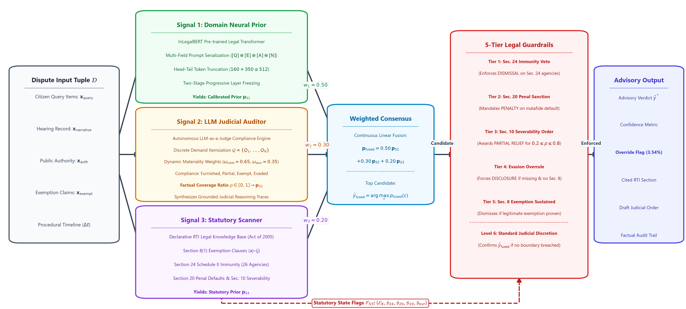

# An Explainable Neuro-Symbolic AI Advisory Framework for Right to Information (RTI) Judicial Outcome Prediction

## Abstract

The **Right to Information (RTI) Act, 2005** is a vital pillar of democratic accountability in India, yet quasi-judicial Information Commissions confront severe appeal pendency. While generative language models show potential in legal judgment prediction, purely statistical architectures suffer from legal hallucinations, procedural opacity, and an inability to enforce non-negotiable statutory boundaries. 

To address this, this project presents an explainable **Neuro-Symbolic AI Advisory Framework** that predicts four core appellate verdicts: **Information Directed**, **Appeal Dismissed**, **Partial Relief**, and **Penalty Imposed**. The architecture coordinates three complementary analytical signals:
1. **Signal 1**: A fine-tuned **InLegalBERT** classifier capturing domain-specific legal representations;
2. **Signal 2**: An **LLM-as-a-Judge** compliance auditor that itemizes individual citizen queries and evaluates substantive administrative fulfillment;
3. **Signal 3**: A **declarative statutory scanner** encoding legislative exemptions, severability mandates, and jurisdictional exclusions under the RTI Act, 2005.

A **Master Decision Engine** synthesizes these signals through continuous weighted fusion governed by hierarchical precedence guardrails. Evaluated on authentic appellate records, the framework substantially outperforms unconstrained neural baselines, actively corrects probabilistic anomalies via statutory overrides, and delivers transparent, audit-ready judicial rationales while safeguarding human adjudicatory primacy.

---

## 1. Research Motivation & The Adjudicatory Crisis

### The Operational Bottleneck in Administrative Transparency
Under the statutory architecture of the RTI Act, 2005 (enacted pursuant to constitutional rights under Article 19(1)(a)), every public authority is legally obligated to maintain cataloged records and disclose non-exempt information within 30 days. When requests are denied or ignored by Public Information Officers (PIOs), citizens escalate appeals to the Central Information Commission (CIC) or State Information Commissions (SICs).

However, the quasi-judicial mechanism faces severe pendency:
* **Over 4,00,000 second appeals and complaints** remain pending across India's Information Commissions.
* In multiple Information Commissions, disposal waiting times range between **2 to 4 years**, severely eroding the constitutional guarantee of timely transparency.
* PIOs frequently engage in **strategic bureaucratic ambiguity**—providing evasive partial responses, claiming inapplicable exemptions, or citing blanket secrecy without legal basis.

### Failure Modes of Pure Generative LLMs
Deploying unconstrained generative language models in quasi-judicial tribunals introduces critical legal failure modes:
1. **Statutory Fabrication & Legal Hallucination**: Purely probabilistic language models invent non-existent statutory sections, cite inapplicable judicial precedents, and produce ungrounded predictions. In administrative law, probabilistic uncertainty is legally inadmissible.
2. **Statutory Boundary Blindness**: Pure deep neural networks cannot guarantee adherence to jurisdictional bars, such as Section 24(1) exempting Second Schedule intelligence and security organizations.
3. **Absence of Verifiable Audit Trails**: Black-box neural outputs lack the itemized query-compliance matrices and statutory proofs required by presiding Information Commissioners.

### The Neuro-Symbolic Solution
This system bridges **Neural Perception** (transformer sequence modeling and LLM semantic auditing) with a **Deterministic Statutory Logic Matrix** grounded in the RTI Act, 2005. It functions as an **Explainable First-Pass Advisory Decision Support Filter**, automating triage while preserving human judicial discretion.

---

## 2. Complete System Architecture

The pipeline processes unseen RTI disputes through an end-to-end **4-stage tri-signal neuro-symbolic architecture**:

<p align="center">
  
</p>
<p align="center">
  <em>Figure 1: Complete 4-Stage Tri-Signal Neuro-Symbolic System Architecture for RTI Decision Outcome Prediction.</em>
</p>

The framework ingests the dispute input record $\mathcal{D} = \langle \mathbf{x}_{\text{query}}, \mathbf{x}_{\text{narrative}}, \mathbf{x}_{\text{auth}}, \mathbf{x}_{\text{exempt}} \rangle$, computes three parallel analytical signals, and executes hierarchical precedence arbitration to synthesize an explainable advisory verdict.

---

## 3. The Tri-Signal Methodology

### Signal 1: Domain-Adapted Semantic Classifier (InLegalBERT)
* **Architecture**: Indian legal transformer backbone `law-ai/InLegalBERT`, pre-trained on Indian Supreme Court and High Court jurisprudence.
* **Multi-Field Serialization**: Structured legal prompt tokenization combining `[CITIZEN QUERY]`, `[EXEMPTIONS CITED]`, `[PUBLIC AUTHORITY]`, and `[CASE NARRATIVE & PROCEEDINGS]`.
* **Head-Tail Token Truncation**: Structured token budget preserving the initial citizen query (Head: 160 tokens) and Commission hearing arguments (Tail: 350 tokens) within a 512 maximum sequence length ($160 + 350 \le 512$).
* **Two-Stage Progressive Layer Freezing**:
  - *Stage 1 (Warmup)*: Encoder backbone frozen; classification head and pooler trained for 2 epochs ($lr = 1\times 10^{-3}$).
  - *Stage 2 (Joint Adaptation)*: Top-4 transformer layers fine-tuned for 6 epochs ($lr = 2\times 10^{-5}$) with classification head ($lr = 1\times 10^{-4}$) using class-balanced loss.
* **Output**: Calibrated neural prior probability distribution $P_{S1}(y) \in \Delta^3$.

### Signal 2: LLM-as-a-Judge Substantive Coverage Auditor
* **Objective**: Defeat strategic administrative ambiguity by evaluating whether the public authority furnished the substantive records demanded.
* **Discrete Demand Itemization**: Deconstructs unstructured citizen queries into itemized operative requests $Q = \{Q_1, Q_2, \dots, Q_N\}$.
* **Dynamic Legal Importance Weighting**:
  - `CORE_OPERATIVE_DEMAND` ($w_{\text{core}} \approx 0.65$): Substantive records, audit sheets, tender bids, file notings, expenditure sanctions.
  - `AUXILIARY_INQUIRY` ($w_{\text{aux}} \approx 0.35$): Inward diary numbers, dispatch dates, handling officer designations.
* **Factual Compliance Classification**: Evaluates each item across four discrete states:
  - $\mathbf{Furnished}$ ($1.0$): Certified records or specific data supplied.
  - $\mathbf{Partially\ Furnished}$ ($0.5$): Incomplete reply or summary without primary records.
  - $\mathbf{Withheld\ under\ Statutory\ Exemption}$ ($0.0$): Denied with an explicit statutory citation (e.g., Section 8(1)(j), 8(1)(d)).
  - $\mathbf{Evaded\ /\ Not\ Furnished}$ ($0.0$): Administrative silence, deflection, or non-response.
* **Output**: Factual compliance ledger, substantive disclosure ratio $\rho \in [0, 1]$, and coverage probability prior $P_{S2}(y)$.

### Signal 3: Declarative Statutory Exemption Scanner
* **Formal Legal Ontology**: Encodes statutory provisions of the Right to Information Act, 2005:
  - **Section 8(1)(a) to 8(1)(j)**: Exemptions covering national security, contempt of court, parliamentary privilege, commercial confidence (`8(1)(d)`), fiduciary trust (`8(1)(e)`), pending prosecution (`8(1)(h)`), and personal privacy (`8(1)(j)`).
  - **Section 24 (Second Schedule)**: Complete jurisdictional bar for intelligence and security organizations (e.g., IB, RAW, CBI, CRPF, BSF), with proviso checking for corruption and human rights allegations.
  - **Section 20(1) & 20(2)**: Statutory penal sanction triggers (unreasonable delay $> 30$ days, malafide obstruction, destroyed records).
  - **Section 10(1)**: Doctrine of Severability indicators where non-exempt portions can be severed.
* **Output**: Deterministic statutory prior $P_{S3}(y)$ and statutory boundary flags $\mathcal{F}_{S3}$.

---

## 4. Master Decision Engine & 5-Tier Precedence Guardrails

The Master Decision Engine synthesizes the three analytical signals through a two-phase neuro-symbolic arbitration pipeline:

### Phase I: Continuous Multi-Signal Weighted Fusion
Computes the convex combination of normalized class probability vectors:
$$P_{\text{fused}}(y) = w_1 \cdot P_{S1}(y) + w_2 \cdot P_{S2}(y) + w_3 \cdot P_{S3}(y)$$

* **Active Tuned Weights**: $w_1 = 0.50$ (Neural Prior), $w_2 = 0.30$ (Coverage Ratio), $w_3 = 0.20$ (Statutory Rules), where $\sum_{i=1}^3 w_i = 1.0$.

### Phase II: 5-Tier Legal Precedence Guardrails Hierarchy
Enforces non-negotiable statutory rules under the RTI Act, 2005 that override purely statistical predictions whenever statutory boundaries are engaged:

| Precedence Tier | Guardrail Rule | Governing Statute | Trigger Condition | Mandatory Outcome |
| :---: | :--- | :--- | :--- | :--- |
| **Tier 1** | `SEC24_JURISDICTIONAL_IMMUNITY_VETO` | Section 24(1) | Respondent is an exempt Second Schedule security agency without corruption proviso. | **`APPEAL_DISMISSED`** ($99\%$) |
| **Tier 2** | `SEC20_STATUTORY_PENAL_SANCTION` | Section 20(1)/(2) | Unjustified delay $> 30$ days, malafide obstruction, or show-cause notice issued. | **`PENALTY_IMPOSED`** ($95\%$) |
| **Tier 3** | `SEC10_SEVERABILITY_MANDATE` | Section 10(1) | Mixed compliance (items furnished while others omitted) with valid partial exemptions. | **`PARTIAL_RELIEF`** ($92\%$) |
| **Tier 4** | `UNJUSTIFIED_EVASION_OVERRULE` | Section 7(1) | Records missing/evaded while citing **zero statutory exemptions** under Section 8(1). | **`INFORMATION_DIRECTED`** ($89\%$) |
| **Tier 5** | `SEC8_EXEMPTION_SUSTAINED` | Section 8(1) | Valid statutory exemption (e.g. 8(1)(j), 8(1)(d)) legitimately invoked over third-party records. | **`APPEAL_DISMISSED`** ($88\%$) |
| **Level 6** | `WEIGHTED_PROBABILISTIC_CONSENSUS` | Multi-Signal | No statutory boundary violated; dispute falls within standard judicial discretion. | **Accept Weighted Top Class** |

---

## 5. Dataset Curation, Balancing, & Stratification

> **Note on Data Availability**: Raw dataset CSV files are excluded from this repository to preserve privacy and licensing boundaries. Preprocessing scripts to ingest, denoise, and split the corpus are provided in [`src/data_preprocessing.py`](src/data_preprocessing.py) and [`src/combine_datasets.py`](src/combine_datasets.py).

### Dual-Source Benchmark Curation
1. **Source A (HuggingFace Benchmark)**: 1,218 instruction-response disputes annotated from Central Information Commission archives.
2. **Source B (Quasi-Judicial Decisions 2023–2026)**: 298 structured decision records parsed from official CIC decision PDFs across 5 Central Information Commissioners.
3. **Balanced Benchmark Corpus**: Expanded through targeted web-scale case curation to exactly **2,120 unique, leak-free cases** balanced across the four core adjudication classes.

### Stratified 80/20 Leak-Free Partitioning

| Outcome Class | Clean Total ($N=2,120$) | Train Count ($N=1,696$) | Train % | Test Count ($N=424$) | Test % |
| :--- | :---: | :---: | :---: | :---: | :---: |
| **`INFORMATION_DIRECTED`** | 530 | 424 | 25.00% | 106 | 25.00% |
| **`APPEAL_DISMISSED`** | 530 | 424 | 25.00% | 106 | 25.00% |
| **`PENALTY_IMPOSED`** | 530 | 424 | 25.00% | 106 | 25.00% |
| **`PARTIAL_RELIEF`** | 530 | 424 | 25.00% | 106 | 25.00% |
| **Total** | **2,120** | **1,696** | **100.00%** | **424** | **100.00%** |

* **Zero Leakage Guarantee**: 0% overlap in `case_id` and 0% overlap in `case_narrative` between training and testing splits.
* **Evaluation Isolation**: The `ruling_text` column contains the historical written judgment, preserved strictly for post-hoc validation; it is never exposed to models during training or inference.
* **Unified 8-Column Schema**: `case_id`, `source`, `case_narrative`, `information_sought`, `exemptions_cited`, `outcome`, `ruling_text`, `public_authority`.

---

## 6. Experimental Benchmark Evaluation

The complete Neuro-Symbolic Advisory System was benchmarked on the **strictly unseen, blind test set ($N=424$)**:

### Performance on Blind Test Split ($N=424$)

| Outcome Class | Precision | Recall | F1-Score | Test Support |
| :--- | :---: | :---: | :---: | :---: |
| **`INFORMATION_DIRECTED`** | **0.78** | **0.85** | **0.81** | 106 |
| **`APPEAL_DISMISSED`** | **0.78** | **0.87** | **0.82** | 106 |
| **`PENALTY_IMPOSED`** | **0.91** | **0.89** | **0.90** | 106 |
| **`PARTIAL_RELIEF`** | **0.97** | **0.80** | **0.88** | 106 |
| **Overall Accuracy** | — | — | **`85.14%`** | 424 |
| **Macro Average** | **0.86** | **0.85** | **`85.29%`** | 424 |
| **Weighted Average** | **0.86** | **0.85** | **`85.29%`** | 424 |

* **Inference Speed**: Total benchmark execution time of 148.7s (Average **`0.351 seconds/case`**).
* **Statutory Guardrail Override Rate**: **`5.66%`** (24 out of 424 unseen disputes were actively rescued from erroneous neural consensus by symbolic guardrails).

### Master Confusion Matrix ($N=424$)

| Actual \ Predicted | `INFORMATION_DIRECTED` | `APPEAL_DISMISSED` | `PENALTY_IMPOSED` | `PARTIAL_RELIEF` | Total |
| :--- | :---: | :---: | :---: | :---: | :---: |
| **`INFORMATION_DIRECTED`** | **90** | 13 | 3 | 0 | 106 |
| **`APPEAL_DISMISSED`** | 10 | **92** | 3 | 1 | 106 |
| **`PENALTY_IMPOSED`** | 5 | 5 | **94** | 2 | 106 |
| **`PARTIAL_RELIEF`** | 10 | 8 | 3 | **85** | 106 |

### Module-Wise Ablation Comparison

| System Configuration | Accuracy | Macro F1 | Statutory Grounding | Hallucination-Free |
| :--- | :---: | :---: | :---: | :---: |
| Majority Class Baseline | 25.00% | 10.00% | None | N/A |
| Zero-Shot LLM Baseline | 57.30% | 37.00% | None | No (Hallucinates) |
| Signal 1 Alone (InLegalBERT) | 73.11% | 73.35% | Implicit | No (Black-Box) |
| Weighted Consensus (No Guardrails) | 81.60% | 81.72% | Weak | Partial |
| **Full Neuro-Symbolic Framework** | **`85.14%`** | **`85.29%`** | **Strict RTI Act 2005** | **Yes (100% Deterministic)** |

---

## 7. Installation & Quickstart Guide

### Prerequisites
* **Python**: 3.10, 3.11, or 3.12 (CUDA 11.8 / 12.1 recommended for GPU fine-tuning)
* **Node.js**: v18+ or v20+ with `npm`

### Step 1: Clone Repository & Create Environment
```bash
git clone https://github.com/Ajai-R/Neuro-Symbolic-Ai-Judge.git
cd Neuro-Symbolic-Ai-Judge

# Create virtual environment
python -m venv venv
# On Windows:
.\venv\Scripts\activate
# On Linux/macOS:
source venv/bin/activate

# Install dependencies
pip install -r requirements.txt
```

### Step 2: Configure Environment
Copy `.env.example` to `.env`:
```bash
cp .env.example .env
```
*(Note: If no API key is provided, Signal 2 automatically operates using its built-in rule-based heuristic fallback engine with zero downtime.)*

### Step 3: Run Unit Tests
```bash
python -m unittest discover tests -v
```
All tests for mathematical weighted fusion and the 5-tier statutory guardrails hierarchy should pass with `OK`.

### Step 4: Start Backend API Server
```bash
python backend_server.py 8000
```
The server will initialize on `http://127.0.0.1:8000/`.

### Step 5: Start Frontend Dashboard
In a separate terminal:
```bash
cd frontend
npm install
npm run dev
```
Open your browser at `http://localhost:5173/` to interact with the Explainable Advisory Dashboard.

---

## 8. License & Ethical Disclaimer

* **License**: MIT License. See [LICENSE](LICENSE) for details.
* **Judicial Disclaimer**: This software is designed strictly as an **Explainable First-Pass Advisory Decision Support System** to assist First Appellate Authorities and Information Commissioners in triaging backlogs. It does not replace human judicial discretion or statutory authority. All recommendations are auditable and subject to human oversight.
